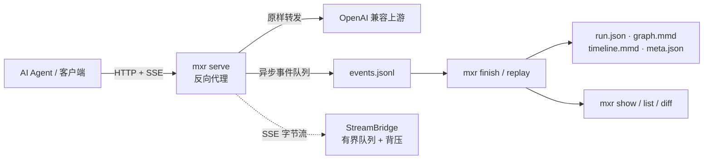

# mini_xray

[](https://github.com/loadwww/mini-xray/actions/workflows/ci.yml)

**一个用 C++17 写的本地反向代理：把 AI Agent 与 OpenAI 兼容 API 之间的 HTTP/SSE 流量录下来，再还原成执行图。**

它是重写式学习项目的产物（`mxr` 是命令行名），目标是「看得懂、改得动、敢发布」，不是生产级可观测平台。想看设计取舍请直接读 [docs/ARCHITECTURE.md](docs/ARCHITECTURE.md)，想看诚实的不足请跳到 [Limitations](#limitations)。

## 30 秒上手

### Windows（VS2022 + CMake + Ninja）

在 **x64 Native Tools Command Prompt for VS 2022** 里：

```bat
git clone https://github.com/loadwww/mini-xray.git
cd mini-xray
powershell -ExecutionPolicy Bypass -File scripts\build.ps1
build\mxr.exe selftest
tests\e2e.ps1
```

### Linux（Ubuntu 22.04+，cmake / ninja-build / python3）

```bash
git clone https://github.com/loadwww/mini-xray.git
cd mini-xray
cmake -S . -B build -G Ninja && cmake --build build
./build/mxr selftest
bash tests/e2e.sh
```

`selftest` 跑 18 台验证台，e2e 真起进程、发 3 个请求并断言落盘产物。两条命令都以退出码 0 表示通过。

### 看一次真实会话的产物

仓库自带的 `config.json` 把 `/v1` 前缀转发到 `http://127.0.0.1:9100/v1`。先起假上游，再起代理，然后把 agent 的 API base URL 指到 `http://127.0.0.1:8080`：

```bat
build\mock_upstream.exe 9100
build\mxr.exe serve config.json
```

Ctrl+C 优雅退出后（Windows 一条龙可用 `mxr run -- <你的 agent 命令>`），会话落在 `runs/<session-id>/`：

```
runs/<session-id>/
├─ events.jsonl     原始事件流（req / resp / sse_chunk / sse_end …）
├─ run.json         还原后的主 Run（Step / ToolExec）
├─ graph.mmd        Mermaid 执行图
├─ timeline.mmd     Mermaid 时间线
└─ meta.json        统计与完成标记（最后写）
```

离线重建与查询：

```bash
mxr finish <session-id>          # 从 events.jsonl 重建报告包
mxr replay runs/<id>/events.jsonl # 重放 SSE 并与 sse_end 对账
mxr list                          # 按时间倒序列会话
mxr show runs/<id>                # 打印摘要
mxr diff <session-a> <session-b>  # 找首个分叉点
```

> 产物文件名以 `src/store/finalize.cpp` 为准；`report.md` 目前由 `emitReport()` 生成成字符串，**尚未落盘**。

## 它怎么工作



三个关键边界：**httplib 处理 TCP/HTTP 分帧**，**StreamBridge 负责跨线程搬字节**，**SseAccumulator 解析 SSE 两级缓冲**。字节经过哪一层，按这三层从上往下数即可。

## 支持矩阵

| 能力 | Windows | Linux（Ubuntu CI 实跑） | macOS |
|---|---|---|---|
| 构建 + selftest + fixture | ✅ | ✅ | 未验证 |
| `serve` 反向代理与 SSE 流式录制 | ✅ | ✅ | 未验证 |
| `run` 起代理 + 子进程一条龙 | ✅ | ❌ 用 `serve` + `finish` | ❌ |
| e2e 脚本 | `tests/e2e.ps1` | `tests/e2e.sh` | 未验证 |
| Web UI 路由 | 代码与验证台具备，未挂到 `serve` | 同左 | 未验证 |
| HTTPS / TLS 终结 | ❌ | ❌ | ❌ |

## Limitations

这些都是当前的真实边界，不是待办话术：

1. **`run` 只实现了 Windows**：依赖 `CreateProcessW` 与控制台事件；Linux 必须自己起 `serve`、发请求、再 `mxr finish`，CI 里的 e2e 就是这么做的。
2. **只代理明文 HTTP**：不做 TLS 终结，也不校验证书；HTTPS 场景需要外部反向代理先卸载 TLS。
3. **协议只认 OpenAI Chat Completions 风格**：靠 `tool_calls[].id` ↔ `role:"tool".tool_call_id` 配对；Anthropic 工具块、Responses API 的 `call_id` 只是备忘，没有实现提取。
4. **执行图依赖 messages 前缀严格追加**：agent 若改写历史（删改消息、重排、重置），链会断开或误合并；推断出的因果关系不是事实。
5. **并行工具的耗时是推断值**：代理只看得到「上一响应结束 → 下一请求开始」这个区间，N 个并行工具都记整个区间并打 `durationInferred`，不是逐个工具的真实耗时。
6. **事件落盘会丢**：Recorder 是有界队列，磁盘跟不上时直接丢弃并计数（`dropped_events`，退出时打印），不向客户端施加背压。
7. **Web UI 还没接进主链**：`registerWebUi()` 有实现、有验证台覆盖，但 `mxr serve` 当前没有注册这些路由，浏览器打开代理端口看不到页面。
8. **`prune` 是占位命令**：只报「暂未实现」并返回失败码；旧会话要自己删。
9. **单进程、静态配置**：上游列表只在启动时读一次，没有热重载；没有认证，不要暴露到不受信网络。
10. **发布产物是 Debug 构建**：没有做 Release 优化和吞吐基准，别拿它做性能结论。

## 测试

```bash
mxr selftest              # Windows 18 台 / Linux 17 台（spawn_test 仅 Windows）
bash tests/e2e.sh         # 端到端：真起进程、发请求、断言产物、清理端口
```

`selftest` 覆盖解析、落盘、还原、CLI、Web UI 路由与 fixture 回归（78 条断言）；
`mxr selftest --list` 列出全部验证台，也可以只跑其中几台。
CI 在 `windows-latest` 和 `ubuntu-latest` 两个 job 上跑同样的构建与测试；
退出码 0/1/2 分别表示成功、运行失败、用法错误。

## 文档

- [docs/ARCHITECTURE.md](docs/ARCHITECTURE.md) — 模块边界、数据流、线程模型、平台边界
- [CONTRIBUTING.md](CONTRIBUTING.md) — 构建与测试步骤、提交前检查
- [markdown/NOTES.md](markdown/NOTES.md) — 重建手册（环境与踩坑）
- [markdown/notes/](markdown/notes/) — 每关概念性口试回顾
- [markdown/reference/](markdown/reference/) — API 原型速查

## License

[MIT](LICENSE)
