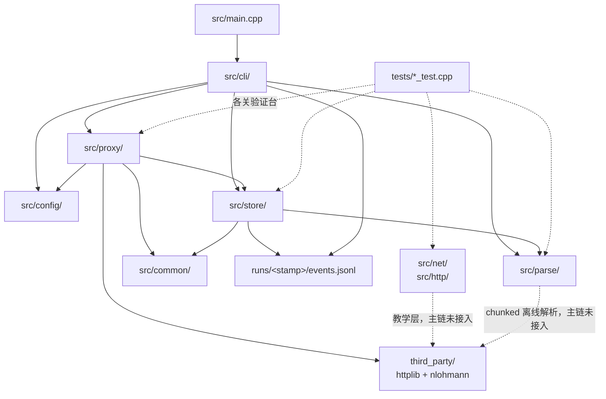
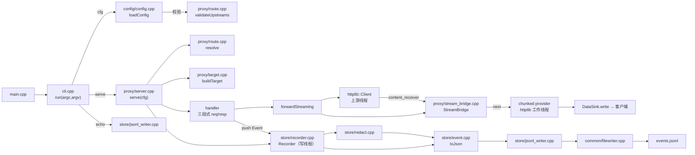
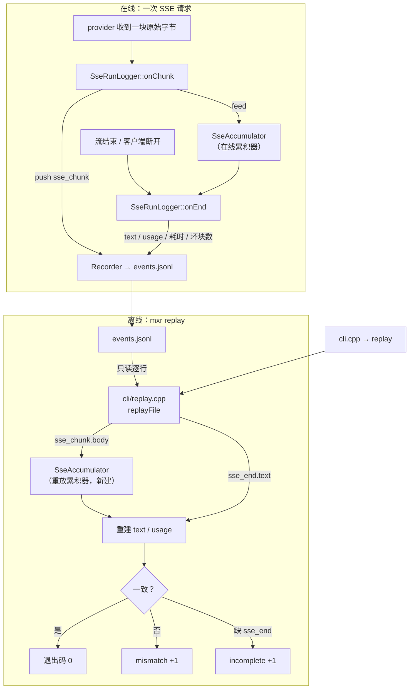

# mini_xray 调用关系图

> 生成于 M4（T4.4）收口时。箭头方向 = **调用 / include 的方向**（A → B 表示 A 用到了 B）。
> 实线 = 运行时主链；虚线 = 离线 / 教学层 / 尚未接入主链。

## 一、目录层依赖



**读法**：`cli/` 是总入口，`proxy/` 是转发核心，`store/` 管落盘，`parse/` 管字节/文本解析。
`net/` 与 `http/` 是 M2 手写 HTTP 的教学产物，被 M3 起的 httplib 主链取代，只由验证台使用；
`parse/chunked.cpp` 同理（httplib 客户端侧已解 chunked），它的舞台在 M5 离线解析。

## 二、运行时主链（`mxr serve`）



**两条线程、一座桥**：上游线程调 `push()`，httplib 工作线程调 `next()`，`StreamBridge` 的有界队列在中间做背压。
handler 只等响应头就返回，之后客户端看到的每一块都由 provider 从桥上取。

## 三、M4 的在线 / 离线闭环（T4.3 + T4.4）



**为什么对账成立**：两边用的是**同一个** `parse/sse.cpp` 的 `SseAccumulator`；
在线喂的是收到的字节，离线喂的是文件里的 `sse_chunk.body`。
如果落盘时字节被改了、块丢了、顺序乱了，重建结果就会和 `sse_end` 不一致。

## 四、重要 cpp 一览（谁负责什么）

| 文件 | 职责 | 被谁调 |
|---|---|---|
| `src/main.cpp` | 只做一次转调 | — |
| `src/cli/cli.cpp` | 子命令分派、全局 flag、退出码 | main |
| `src/cli/replay.cpp` | 离线重放与对账，只读 | cli（`replay`） |
| `src/config/config.cpp` | 读配置、`Config` 结构 | cli、route/target/server |
| `src/proxy/route.cpp` | 路径段前缀匹配、剥前缀、启动期校验 | cli、server |
| `src/proxy/target.cpp` | 拆 origin / 拼目标 URL | server |
| `src/proxy/server.cpp` | handler 三段式、转发两种模式、Ctrl+C 优雅退出 | cli |
| `src/proxy/stream_bridge.cpp` | 跨线程有界字节队列 + 背压 | server |
| `src/store/recorder.cpp` | 异步写线程、脱敏、截断、seq 分配 | server |
| `src/store/event.cpp` | 事件 → JSON 的稳定 schema | recorder |
| `src/store/redact.cpp` | 落盘前脱敏（正则） | recorder |
| `src/store/jsonl_writer.cpp` / `common/filewriter.cpp` | 整行追加 + flush / 文件句柄 | recorder、cli（echo） |
| `src/store/sse_run.cpp` | 一条流的在线记录员（累积器 + 序号 + 收尾） | server（provider） |
| `src/parse/sse.cpp` | SSE 两级缓冲状态机、字段提取 | sse_run（在线）、replay（离线） |
| `src/parse/chunked.cpp` | chunked 分帧解码 | 目前只有验证台；M5 离线解析会接 |
| `src/common/clock.cpp` | `nowMs()`、`stampNow()` | server、sse_run |
| `src/net/*`、`src/http/*` | M2 手写 socket / HTTP 解析 | 只有验证台 |

## 五、一张图记住边界

```
客户端 ──HTTP──> [proxy/server.cpp] ──HTTP──> 上游
                      │  │
       跨线程字节队列 ─┘  └─ 事件队列 ──> [store] ──> events.jsonl
       (StreamBridge)      (Recorder)          │
                                                └──> [cli/replay.cpp] 只读重建
```

三层缓冲各管一段：**TCP/HTTP 分帧**（httplib 内部）、**跨线程队列**（StreamBridge）、
**SSE 两级缓冲**（SseAccumulator）。回答"一个字节经过了哪几层"时，按这三层从上往下数即可。
